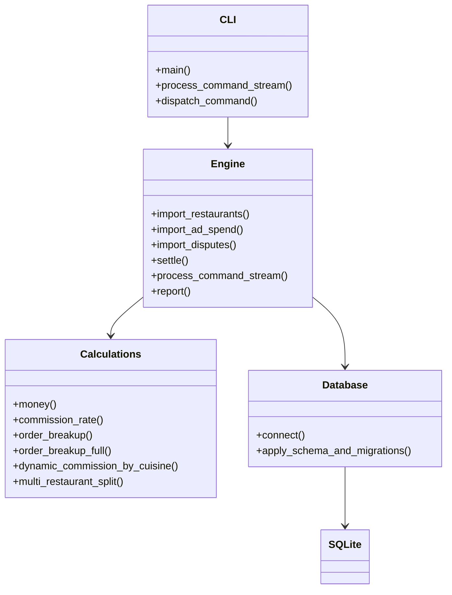
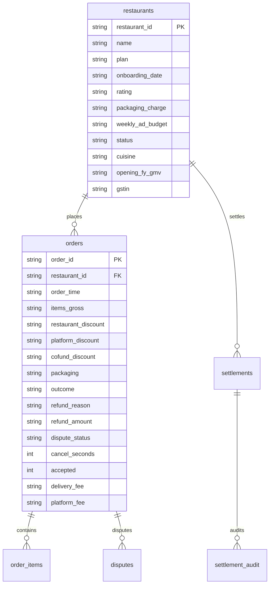

# PS-039 Food Delivery Commission & Restaurant Payout Engine — Design Document

## 1. Architecture & System Overview

The engine calculates restaurant-side settlements for food delivery platforms, determining net weekly earnings after commissions, ad deductions, party-funded discounts, customer/restaurant cancellations, refund funding allocations, Section 194-O TDS, and Section 9(5) GST statutory deductions.

The system is **command-file driven** (no UI), designed for restaurant partner managers to verify payouts and resolve dispute inquiries down to the paisa.



### Components
1. **`main.py`**: CLI entry point supporting direct command file execution (`python main.py commands.txt`), explicit pipeline invocation (`run-commands`), and granular administrative operations.
2. **`src/engine.py`**: Orchestrates command parsing, order lifecycle state machines, weekly payout aggregation, dispute exclusions, rating uplift/suspension tracking, and CSV evaluation generation.
3. **`src/calculations.py`**: Pure, side-effect-free financial arithmetic using `Decimal` with `ROUND_HALF_UP` paise quantization. Implements core rules BR-01 through BR-11 and viva stretch goals.
4. **`database/database.py` & `database/schema.sql`**: SQLite persistence maintaining audit trails, settlement snapshots, and ledger constraints.

---

## 2. Processing Flow (Evaluation Pipeline)

```mermaid
flowchart TD
    CF[commands.txt Stream] --> Parser[Command Stream Parser]
    Parser -->|ORDER| OrdState[Order Ingestion & State Setup]
    Parser -->|ACCEPTED| AccState[Mark Accepted for Cancellation Liability]
    Parser -->|DELIVERED| DelState[Delivery Timestamp & Rating Capture]
    Parser -->|CANCEL_CUSTOMER| CustCan[60s Free vs Charged Branch]
    Parser -->|CANCEL_RESTAURANT| RestCan[Rs 100 Penalty & Full Refund Debit]
    Parser -->|REFUND| RefAlloc[MISSING_ITEM / SPILLED / LATE_DELIVERY Split]
    Parser -->|PAYOUT| PayoutEng[Weekly Settlement & Dispute Resolver]
    Parser -->|PRINT_BREAKUP| BreakupOut[order_breakup.csv (23 columns)]
    Parser -->|PRINT_STATEMENT| StmtOut[weekly_statement.csv (12 columns)]
    PayoutEng --> AdDeduct[Ad Budget Cap, Zero Floor & Debit Carry]
    PayoutEng --> RatingCalc[Weekly Average Rating & Next Week Status]
```

### Stream Lifecycle:
1. **Order Intake (`ORDER`)**: Parses line items (`name:qty:unit_price`). If restaurant is suspended from prior week's low rating (< 3.0), the order is immediately `REJECTED`.
2. **Acceptance (`ACCEPTED`)**: Flags restaurant acceptance, enabling the Rs 100 penalty if restaurant cancels later.
3. **Delivery (`DELIVERED`)**: Records completion and rating (1–5). Handles rider-app retries idempotently.
4. **Cancellations (`CANCEL_CUSTOMER` / `CANCEL_RESTAURANT`)**:
   - Customer cancellation $\le 60$s is free (`CANCELLED_BY_CUSTOMER_FREE`).
   - Customer cancellation $> 60$s is charged 100% (`CANCELLED_BY_CUSTOMER_CHARGED`).
   - Restaurant cancellation after acceptance triggers Rs 100 penalty and customer refund debit.
5. **Partial Refunds (`REFUND`)**: Allocates by category (`MISSING_ITEM`: 100% restaurant; `SPILLED`: 50:50 with odd paisa to platform; `LATE_DELIVERY`: 100% platform). Rejects invalid categories (e.g. `COLD_FOOD`).
6. **Payout Execution (`PAYOUT`)**: Runs for Monday–Sunday week. Orders with open disputes are excluded. Unpaid ad spend rolls forward as debit.
7. **Reporting (`PRINT_BREAKUP`, `PRINT_STATEMENT`)**: Outputs `order_breakup.csv` and `weekly_statement.csv`.

---

## 3. Database Schema Design



---

## 4. Evaluation Output Format

### `order_breakup.csv` (23 columns)
`order_id, restaurant_id, status, gross_item_value, restaurant_discount, platform_coupon, cofunded_restaurant_share, cofunded_platform_share, net_item_value, packaging_allowed, packaging_disallowed, commission_rate, commission, platform_fee, gst_on_commission, gst_9_5, tds_194o, coupon_reimbursement, refund_restaurant_share, refund_platform_share, penalty, restaurant_net, rule_ids`

### `weekly_statement.csv` (12 columns)
`restaurant_id, week_start, orders_settled, orders_excluded_dispute, gross_payable, ad_spend_deducted, debit_brought_forward, net_payout, debit_carried_forward, avg_rating, next_week_commission_uplift_pp, suspended_next_week`

---

## 5. Stretch Goals (Optional Extra Credit)

1. **Multi-Restaurant Order Split**: Partitioned line-item settlement supporting multiple restaurants on a single customer basket. Computes individual commissions, packaging allowances, and net payouts.
2. **Dynamic Commission by Cuisine Demand**: Algorithmic surge pricing for take-rates based on cuisine category demand elasticities (e.g., Biryani peak demand multiplier).
