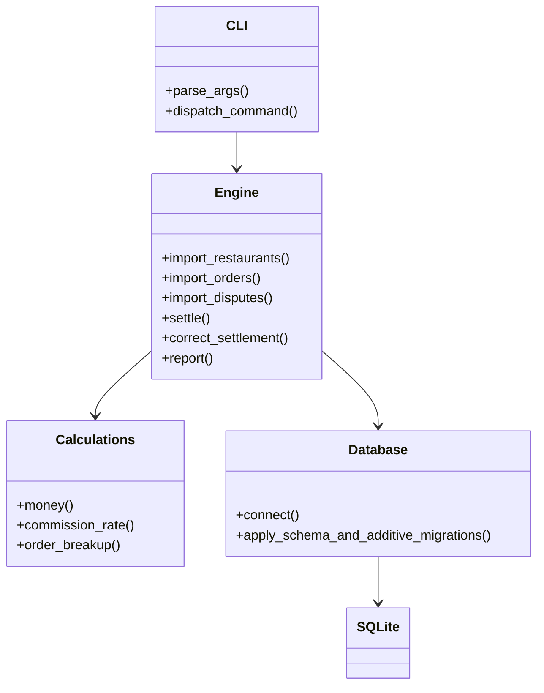
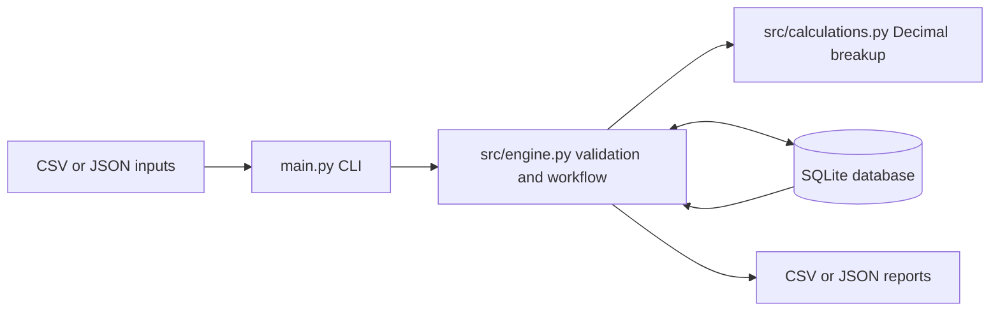
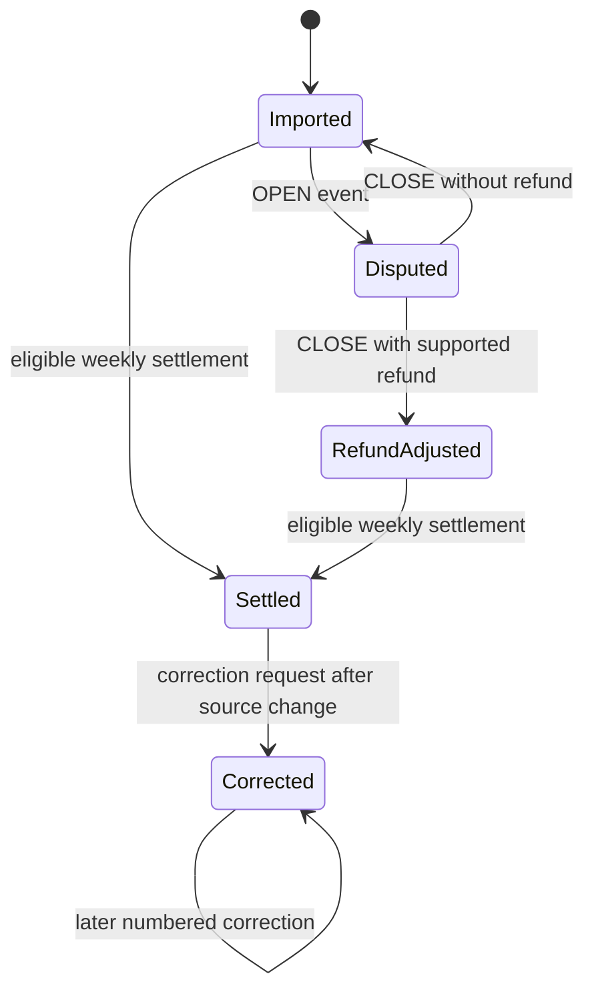

# Design

## Architecture

`main.py` provides the command line. `src/calculations.py` contains side-effect-free Decimal formulas. `src/engine.py` validates CSV/JSON, writes source records, closes disputes, builds weekly statements, and exports reports. `database/database.py` opens SQLite and applies `database/schema.sql` on each connection. The existing database file is `database/settlements.sqlite3`.

The CLI translates arguments into engine calls and serializes successful results as JSON. The engine owns validation, transaction boundaries, persistence and orchestration. Calculation functions receive order and restaurant data and return a breakup without opening a database connection. SQLite enforces keys and relationships while exact arithmetic remains in Python.

## Processing flow

1. Register restaurant profiles.
2. Import orders (including optional item rows and dispute status). A SHA-256 history entry makes identical file imports idempotent.
3. Inspect `order-breakup` before settlement.
4. Open disputes remain unassigned. CSV dispute events can open or close a dispute; an explicit supported refund amount can update the order refund ledger.
5. Weekly settlement selects unassigned eligible orders, calculates one statement, records a complete per-order audit snapshot, then locks those orders to its unique statement.
6. A post-settlement dispute change uses `correct-settlement`. The original statement and audit are retained; a new revision and correction audit are appended. Reports display the latest statement revision and both audit histories.
7. Reports export calculated order breakups, current settlement revisions, and audit history as CSV or JSON.
8. Imports validate required fields and numeric flags before commit. Duplicate order IDs within a batch fail the transaction. Failed dispute batches also roll back as a unit. A repeated correction with no changed monetary result does not append a duplicate revision.

## Order, settlement and dispute states

Open disputes are excluded from settlement. On closure, the close timestamp determines the assigned payout week. A settled order remains attached to its original statement; a later dispute adjustment creates a correction revision rather than rewriting that statement.

## Database interactions and transaction boundaries

`connect()` enables foreign keys, executes the idempotent schema, and applies additive column migrations when needed. Restaurant and order imports commit complete files, dispute event files commit as a unit, settlement creation stores the statement/audit/order links together, and correction creation stores the revision and its per-order audit rows together. Unique keys protect order IDs, restaurant/week statements, dispute IDs, correction revisions and per-settlement audit orders. Source records, statement history and original audit snapshots are retained.

## Settlement workflow

1. Validate that the requested week starts on Monday and load the restaurant.
2. Select unassigned orders whose order date is in the requested week, or whose dispute close date is in that week; omit open disputes.
3. Determine the prior-week rating adjustment and calculate each order breakup.
4. Calculate TDS in financial-year order, aggregate statement totals, cap ads by budget and positive available payout, and retain unpaid ad debit.
5. In one database transaction, insert the unique statement and per-order audit, assign the orders, update ad debit, then commit.

## Dispute and correction workflows

An OPEN event creates a dispute record and marks the order open. A matching CLOSE event must not predate OPEN. Only an explicit positive amount with a supported funding reason adjusts the order refund ledger. If its refund funder conflicts with a prior refund reason, the event is rejected. After settlement, `correct-settlement` recomputes the statement from its source orders and appends a numbered revision with per-order audit snapshots. Later settlements are not automatically cascaded; this remains a pending policy/implementation limitation.

## Money and reporting

All money values are Decimal text in SQLite and quantized to two decimal places with ROUND_HALF_UP. TDS GMV is iterated in chronological order without converting to binary floating point. Commission uses gross less restaurant-funded discount; packaging is separate. A sub-Rs 100 order pays the fixed platform fee instead of commission. Section 9(5) GST is displayed as a deduction because the platform withholds and remits it for the restaurant. Delivery fees are totalled for visibility but excluded from payout pending a specified recipient/funding rule; see the README for assumptions.

## Inputs

Restaurant columns: `restaurant_id,name,plan,onboarding_date,rating,packaging_charge,weekly_ad_budget` (optional status). Order columns: `order_id,restaurant_id,order_time,items_gross` plus optional discounts, packaging, distance, mode, outcome, refund fields, dispute fields, cancel seconds, accepted flag, delivery fee, platform fee, rating. Itemized CSV repeats order fields on each line and uses `item_name,item_quantity,item_unit_price`; aggregate CSV remains compatible. JSON order objects may add `items:[{name,quantity,unit_price}]`. Dispute CSV events use `dispute_id,order_id,event,event_at,resolution,refund_amount,refund_reason`.

## Known scope choices

Rates and GST bases follow the supplied brief, with unresolved cancellation tax treatment documented separately. Platform fee below Rs 100 uses the specified flat minimum; other platform fees are accepted as already-calculated amounts. Delivery fees are recorded but not allocated without a defined recipient. Rating averages from the prior week set the following week's commission rate. For `SPILLED` refunds, the platform receives half rounded half-up to paise and the restaurant receives the remainder. See `decision_log.md` for exact interpretations and correction limits, and `br_traceability.md` for rule-to-test links.
